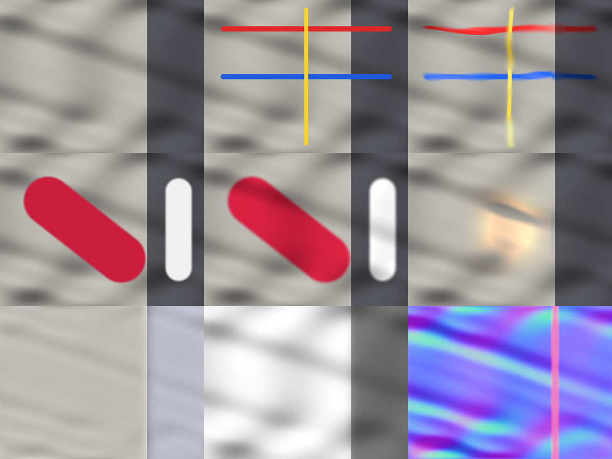

# Surface Brush – Photoshop-Plugin

Ein UXP-Panel für Photoshop, das Malen und Bearbeiten an die **Form, Farbe und Beleuchtung** des Bildes koppelt – dieselbe Art von Funktionen, die Adobe als Forschungsprojekt „Project Deep Brush“ gezeigt hat:

| Modus | Was er macht |
|---|---|
| **Pinsel** | Striche legen sich auf die Oberfläche: Sie biegen sich über Falten, laufen an ihnen entlang und übernehmen deren Schatten. |
| **Umfärben** | Grob übermalte Flächen bekommen die neue Farbe, Schatten, Falten und Glanzlichter bleiben erhalten (auch Schwarz → Weiß). |
| **Licht** | Ein Farbklecks wird zur Lichtquelle; die Umgebung wird passend zum Relief aufgehellt. |
| **Zerlegen** | Erzeugt Ebenen für Albedo, Schattierung (Multiplizieren) und eine Normalen-Map. |



*Oben: Original, gemalte Striche, Ergebnis „Pinsel“. Mitte: gemalte Flächen, Ergebnis „Umfärben“, Ergebnis „Licht“. Unten: Albedo, Schattierung, Normalen.*

## Wichtig: Unterschiede zum Adobe-Original

- **Keine KI.** Adobes Projekt nutzt ein trainiertes Modell, das Geometrie und Licht „versteht“. Dieses Plugin schätzt Relief und Beleuchtung klassisch aus den Helligkeiten des Bildes. Das funktioniert gut auf Stoff, Papier, Haut, Wänden – also Flächen, deren Helligkeitsverlauf von der Form kommt. Bei gemusterten oder bedruckten Flächen hält es das Muster fälschlich für Relief.
- **Live heißt: pro Strich.** Photoshop erlaubt Plugins nicht, in das Pinsel-Werkzeug einzugreifen. Im Live-Modus sieht man deshalb während des Malens den normalen Strich; beim Loslassen wird er sofort auf die Oberfläche gelegt.
- **Stand der Prüfung:** Die Algorithmen und der Ablauf sind automatisiert getestet (siehe unten), aber gegen eine nachgebaute Photoshop-Schnittstelle – in echtem Photoshop wurde das Plugin noch nicht ausgeführt.

## Installation

Voraussetzung: Photoshop **24.4 oder neuer** (2023+).

1. Diesen Ordner `photoshop-surface-brush` herunterladen.
2. **Adobe UXP Developer Tools** aus der Creative-Cloud-App installieren und starten.
3. Photoshop starten.
4. In den Developer Tools: **Add Plugin** → die Datei `manifest.json` in diesem Ordner wählen.
5. Beim Eintrag „Surface Brush“ auf **•••** → **Load** klicken.
6. In Photoshop erscheint das Panel (sonst: *Zusatzmodule › Surface Brush*).

## Bedienung

### Live-Modus

1. Bild öffnen (RGB), Modus wählen (Pinsel / Umfärben / Licht).
2. **Live-Modus starten** – es werden eine Ergebnisebene und eine Live-Malebene angelegt, der Pinsel ist gewählt.
3. Malen. Jeder Strich wird beim Loslassen übernommen; Regleränderungen gelten ab dem nächsten Strich.
4. **Strich zurück** nimmt den letzten Strich zurück (Photoshops eigenes Rückgängig eignet sich im Live-Modus nicht, weil der Strich sofort wieder übernommen wird).
5. Ein Moduswechsel beginnt eine neue Ergebnisebene. **Live-Modus beenden** entfernt die Malebene, das Ergebnis bleibt.

Das Bild unter den Strichen wird beim Start einmal eingelesen. Wer danach das Foto selbst verändert, startet den Live-Modus neu.

### Manuell

1. Bild öffnen (RGB).
2. Im Panel **1 · Neue Malebene** klicken – es wird eine leere Ebene angelegt und der Pinsel gewählt.
3. Mit einem beliebigen Photoshop-Pinsel malen (Farbe, Größe, Härte, Druck wie gewohnt).
4. Modus wählen (Pinsel / Umfärben / Licht) und **2 · Anwenden** klicken.
5. Regler ändern und erneut **Anwenden** ersetzt das Ergebnis. Mit Strg/Cmd+Z geht alles in einem Schritt zurück.

### Claude

Im Tab **Claude** beschreibst du in Worten, was passieren soll, z. B. „Färbe den Hoodie dunkelgrün und setze ein warmes Licht von links oben“. Das Plugin schickt eine verkleinerte Fassung des sichtbaren Bildes (lange Seite höchstens 1200 px) mit deiner Anweisung an die Anthropic-API. Claude antwortet mit Aktionen (Umfärben, Malen, Licht) samt Bereichen als Polygonen; das Plugin führt sie aus, je Aktion eine neue Ebene.

- Du brauchst einen eigenen **Anthropic-API-Schlüssel** (console.anthropic.com). Er wird nur auf deinem Rechner gespeichert; die Nutzung wird über diesen Schlüssel abgerechnet.
- Verwendet wird das Modell `claude-opus-5-5`.
- Claude gibt Bereiche nur grob als Umriss an. Beim Umfärben rastet das Plugin die Kante an Objektkanten ein, pixelgenaue Masken darfst du nicht erwarten.
- Der Live-Modus muss dafür beendet sein.

### Automatik

Ist **Automatik** angehakt (Standard), misst das Plugin die Breite jedes Strichs und leitet daraus Wölbung, Faltenfluss, Kanten-Fang und Licht-Ausbreitung ab. Die Faltengröße wird je Strich aus dem Bild bestimmt: Es wird die Strukturgröße gewählt, bei der der Bildbereich das stärkste Relief zeigt. Die Längen-Regler sind dann ausgeblendet; ohne Haken gelten wieder die Regler.

### Regler

Die Längen-Regler (Wölbung, Faltenfluss, Kanten-Fang, Ausbreitung, Faltengröße) beziehen sich auf ein Bild mit 1500 px langer Seite und wachsen automatisch mit der Bildgröße.

- **Faltengröße** – wie groß die Strukturen sind, denen gefolgt wird (klein = feine Knitter, groß = große Falten).
- **Max. Rechenauflösung** – große Bereiche werden intern verkleinert gerechnet; höher = mehr Detail, langsamer, mehr Speicher.
- *Pinsel:* **Wölbung** (Verformung über das Relief), **Faltenfluss** (Verlaufen entlang der Falten), **Schatten übernehmen**.
- *Umfärben:* **Kanten-Fang** (grobe Maske rastet an Objektkanten ein), **Schatten erhalten**, **Glanzlichter**.
- *Licht:* **Ausbreitung**, **Intensität**, **Höhe der Lichtquelle** (niedrig = Streiflicht, betont das Relief), **Relief-Wirkung**.

### Tipps

- Gerechnet wird nur im Bereich der gemalten Striche – kleine Bereiche gehen schnell.
- Für mehrere Farben beim Umfärben: getrennte Flächen dürfen auf derselben Malebene liegen; jede zusammenhängende Fläche bekommt ihre eigene Helligkeits-Referenz.
- 16-Bit-Dokumente: Das Ergebnis wird mit 8 Bit Genauigkeit berechnet.

## Tests (ohne Photoshop)

```
node test/run.js       # Algorithmen auf einem synthetischen Tuch
node test/mock-ps.js   # Ablauf gegen eine Attrappe der Photoshop-API
```

## Aufbau

- `core.js` – Algorithmen (Relief-/Licht-Schätzung, Pinsel, Umfärben, Licht, Zerlegung)
- `ps.js` – Photoshop-Anbindung (Imaging-API, Ebenen, Live-Modus)
- `claude.js` – Anbindung an die Claude-API
- `main.js`, `index.html`, `styles.css` – Panel
- `manifest.json`, `icons/` – Plugin-Beschreibung
