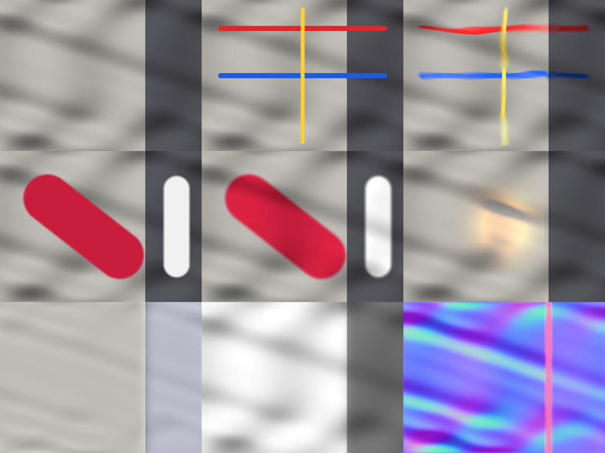

# Surface Brush – Photoshop-Plugin

Ein UXP-Panel für Photoshop, das Malen und Bearbeiten an die **Form, Farbe und Beleuchtung** des Bildes koppelt – dieselbe Art von Funktionen, die Adobe als Forschungsprojekt „Project Deep Brush“ gezeigt hat:

| Modus | Was er macht |
|---|---|
| **Pinsel** | Striche legen sich auf die Oberfläche: Sie biegen sich über Falten, laufen an ihnen entlang und übernehmen deren Schatten. |
| **Umfärben** | Grob übermalte Flächen bekommen die neue Farbe, Schatten, Falten und Glanzlichter bleiben erhalten (auch Schwarz → Weiß). |
| **Licht** | Ein Farbklecks wird zur Lichtquelle; die Umgebung wird passend zum Relief aufgehellt. |
| **Zerlegen** | Erzeugt Ebenen für Albedo, Schattierung (Multiplizieren) und eine Normalen-Map. |



*Oben: Original, gemalte Striche, Ergebnis „Pinsel“. Mitte: gemalte Flächen, Ergebnis „Umfärben“, Ergebnis „Licht“. Unten: Albedo, Schattierung, Normalen.*

## Wichtig: Unterschiede zum Adobe-Original

- **Keine KI.** Adobes Projekt nutzt ein trainiertes Modell, das Geometrie und Licht „versteht“. Dieses Plugin schätzt Relief und Beleuchtung klassisch aus den Helligkeiten des Bildes. Das funktioniert gut auf Stoff, Papier, Haut, Wänden – also Flächen, deren Helligkeitsverlauf von der Form kommt. Bei gemusterten oder bedruckten Flächen hält es das Muster fälschlich für Relief.
- **Nicht live unter dem Pinsel.** Photoshop erlaubt Plugins nicht, in das Pinsel-Werkzeug einzugreifen. Deshalb malt man auf eine eigene Malebene und klickt dann »Anwenden«. Das Ergebnis ist eine neue Ebene; die Malebene bleibt (ausgeblendet) erhalten.
- **Stand der Prüfung:** Die Algorithmen und der Ablauf sind automatisiert getestet (siehe unten), aber gegen eine nachgebaute Photoshop-Schnittstelle – in echtem Photoshop wurde das Plugin noch nicht ausgeführt.

## Installation

Voraussetzung: Photoshop **24.4 oder neuer** (2023+).

1. Diesen Ordner `photoshop-surface-brush` herunterladen.
2. **Adobe UXP Developer Tools** aus der Creative-Cloud-App installieren und starten.
3. Photoshop starten.
4. In den Developer Tools: **Add Plugin** → die Datei `manifest.json` in diesem Ordner wählen.
5. Beim Eintrag „Surface Brush“ auf **•••** → **Load** klicken.
6. In Photoshop erscheint das Panel (sonst: *Zusatzmodule › Surface Brush*).

## Bedienung

1. Bild öffnen (RGB).
2. Im Panel **1 · Neue Malebene** klicken – es wird eine leere Ebene angelegt und der Pinsel gewählt.
3. Mit einem beliebigen Photoshop-Pinsel malen (Farbe, Größe, Härte, Druck wie gewohnt).
4. Modus wählen (Pinsel / Umfärben / Licht) und **2 · Anwenden** klicken.
5. Regler ändern und erneut **Anwenden** ersetzt das Ergebnis. Mit Strg/Cmd+Z geht alles in einem Schritt zurück.

### Regler

- **Faltengröße** – wie groß die Strukturen sind, denen gefolgt wird (klein = feine Knitter, groß = große Falten).
- **Max. Rechenauflösung** – große Bereiche werden intern verkleinert gerechnet; höher = mehr Detail, langsamer, mehr Speicher.
- *Pinsel:* **Wölbung** (Verformung über das Relief), **Faltenfluss** (Verlaufen entlang der Falten), **Schatten übernehmen**.
- *Umfärben:* **Kanten-Fang** (grobe Maske rastet an Objektkanten ein), **Schatten erhalten**, **Glanzlichter**.
- *Licht:* **Ausbreitung**, **Intensität**, **Höhe der Lichtquelle** (niedrig = Streiflicht, betont das Relief), **Relief-Wirkung**.

### Tipps

- Gerechnet wird nur im Bereich der gemalten Striche – kleine Bereiche gehen schnell.
- Für mehrere Farben beim Umfärben: getrennte Flächen dürfen auf derselben Malebene liegen; jede zusammenhängende Fläche bekommt ihre eigene Helligkeits-Referenz.
- 16-Bit-Dokumente: Das Ergebnis wird mit 8 Bit Genauigkeit berechnet.

## Tests (ohne Photoshop)

```
node test/run.js       # Algorithmen auf einem synthetischen Tuch
node test/mock-ps.js   # Ablauf gegen eine Attrappe der Photoshop-API
```

## Aufbau

- `core.js` – Algorithmen (Relief-/Licht-Schätzung, Pinsel, Umfärben, Licht, Zerlegung)
- `ps.js` – Photoshop-Anbindung (Imaging-API, Ebenen)
- `main.js`, `index.html`, `styles.css` – Panel
- `manifest.json`, `icons/` – Plugin-Beschreibung
